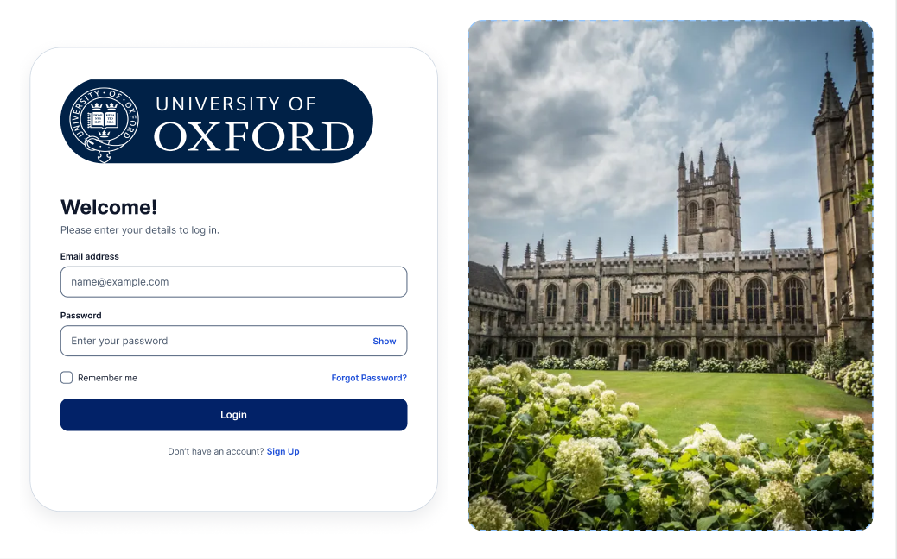

# University of Oxford – Student Login Page (HCI Project)

A responsive login page designed in Figma and built with HTML, CSS and JavaScript.

**Figma design:** https://www.figma.com/design/IWUZ8OUGjrN9ZNeGOAxGyW/login-page

## Features
- University logo, "Welcome!" heading, email and password fields
- Remember Me, Forgot Password, Login button, Sign Up link
- Login card on the left, campus picture on the right (hidden on mobile)
- Show/hide password and simple form validation

## HCI principles applied
- **Visibility:** labels above fields, prominent Login button
- **Consistency:** same navy/blue colors, radius, spacing and font everywhere
- **Affordance:** fields look like inputs, button looks clickable
- **Accessibility:** good contrast, readable text, large touch targets
- **Minimalist design:** only essential elements

## Run
Open `index.html` in a browser.

## Note
The logo and photo were cut from a Figma screenshot. For sharper images, export them from Figma (select the image, Export, PNG) and replace the files in `images/`. The Oxford logo belongs to the University of Oxford and is used here for a student assignment.

## Author
Hamid Mumtaz – rajahamid1818@gmail.com
